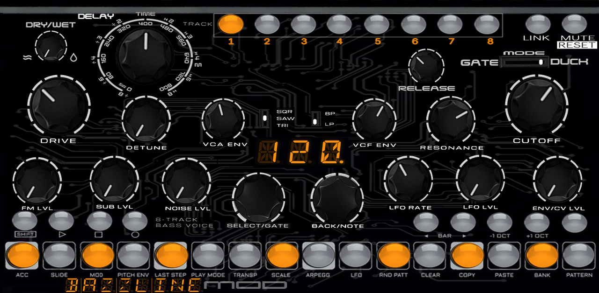
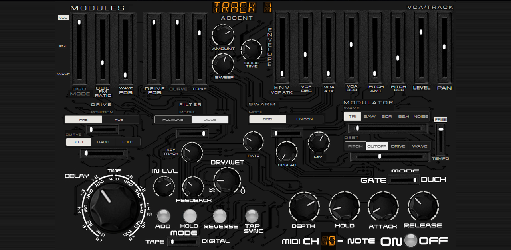
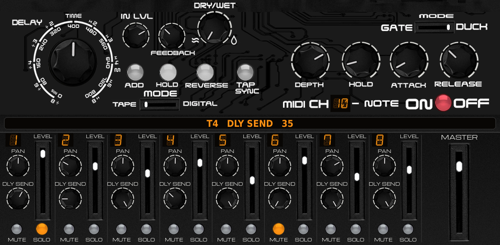
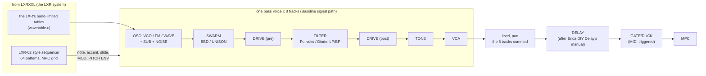

# LXRXXL BAZZLINE v0.2.7





**An 8-track bass synth for the Akai Force and MPC (MPC OS 3.x, VST2 through
[mpc-vst-plugins](https://github.com/sd88me/mpc-vst-plugins)).**

LXRXXL BAZZLINE is a variation of [LXRXXL](https://github.com/sunskiefer/LXR02XXL), a port of the open-source Sonic
Potions LXR engine inspired by the Erica Synths LXR-02. It keeps LXRXXL's LXR-02 style step sequencer, its way of
running on the Force (MPC's grid and transport, the panel on the touchscreen, the project saved with MPC's) and the
LXR's voice system. The drum voices are replaced by eight bass voices, inspired by the Erica Synths Bassline DB-01:
VCO, sub, noise, swarm, drive, a Polivoks-style filter, accent and slide. It is meant for bass: acid, DB-01-style
lines, subs, Reese, FM and 808-style basses. It also has a delay and a gate/duck triggered by MIDI.

> [!IMPORTANT]
> **This is not a DB-01.** The artwork is inspired by the Erica Synths Bassline DB-01, but it is not a copy of the
> DB-01's panel or of any other original artwork. It is an original design by Suns Kiefer. The voices, the delay and
> the gate/duck contain **no code from Erica Synths**. They are written here from scratch, imagining and emulating how
> those circuits behave, from the public manuals. LXRXXL BAZZLINE is not affiliated with or endorsed by Erica Synths,
> Sonic Potions or Akai Professional. DB-01, Bassline and LXR-02 are their makers' names.

**Tested on an Akai Force** (see `tested.json`). Downloads: [Releases](https://github.com/sunskiefer/LXRXXL-BAZZLINE/releases).
Every build is also tested offline (see [Testing](#testing)). Report anything odd under Issues.

## The three pages

MPC shows three tabs, each filling the whole screen: **PANEL**, **MODULES** and **FX MIXER**. PANEL and MODULES edit
the **selected track**, as the DB-01's knobs do: pick a track with TRACK 1-8 (PANEL) or TRACK (MODULES) and every knob
and slider shows that track's sound. FX MIXER has the delay, the gate/duck and a mixer of all eight tracks.

Every knob turns in place. MODULES and FX MIXER have a **readout** in big letters: the control you last touched, its
track and its value (`T3   CUTOFF   75`, `DELAY TIME   400 ms`, `T5   PAN   L 20`).

### PANEL (the front)

| Control | What it does |
|---|---|
| DRIVE | the overdrive, before or after the filter (MODULES: DRIVE, and the POSITION selector) |
| DETUNE | the swarm's spread: BBD detune or unison (MODULES: SWARM) |
| VCA ENV | the amp envelope's decay. Fully down: the VCA follows the gate (organ-like) |
| VCF ENV / RESONANCE / CUTOFF | the filter envelope's amount, the resonance (self-oscillates at the top), the cutoff |
| SQR / SAW / TRI | the VCO's wave |
| BP / LP | the filter's band-pass or low-pass output |
| FM LVL / SUB LVL / NOISE LVL | FM depth (the modulator's ratio: MODULES), the sub oscillator (-1 octave square), white noise |
| LFO RATE / LFO LVL | the modulator's rate and depth (wave, destination and sync: MODULES) |
| ENV/CV LVL | the pitch envelope's amount (up to +4 octaves at the top: kick-basses, 808s) |
| SELECT/GATE | walks the steps of the selected track (the display shows `S 1`..`S64`). SELECT/GATE and BACK/NOTE are endless encoders: each stays where you turned it, so walking the steps doesn't move BACK/NOTE |
| BACK/NOTE | the selected step's note, C0..C6 (it turns the step on); in a function, that function's value (SELECT/GATE stays the step knob, except in LFO, where it picks the wave) |
| DELAY: DRY/WET, TIME | the delay's mix and time (the same as on FX MIXER) |
| RELEASE, GATE / DUCK | the gate/duck's release and mode (the same as on FX MIXER) |
| The display | the tempo (its last dot lit: MPC's tempo), a value while you turn it, the function in use |
| TRACK 1-8 | select a track (a playing track's key glows) |
| LINK | this track plays the steps of the track before it (stack two voices on one line) |
| MUTE | mutes the selected track. **SHIFT + MUTE = RESET**: back to the factory project |
| VOICE RESET (the orange button under the TRACK keys) | the selected track's sound back to the default sound (every knob, slider and selector at its default: an audible saw bass at a sensible level); its steps stay. **SHIFT + VOICE RESET = MUTE ALL**: every track muted and silenced at once (the button stays lit); SHIFT + it again unmutes them all |
| SHIFT, ▷, □, ○ | SHIFT (tap, then a step key: its function), PLAY, STOP, REC |
| ◄ BAR ► | the bar the step keys show (a track is up to 64 steps, 4 bars) |
| -1 OCT / +1 OCT | the selected step's note an octave down / up |
| the key right of +1 OCT | TAP: tap the tempo (the instance's own tempo). SHIFT + TAP: back to MPC's tempo |
| the 16 step keys | the steps of the bar: on / off. Lit = on; the running step blinks through |

**SHIFT, then a step key** is the function printed under it:

| Key | Function |
|---|---|
| ACC, SLIDE, MOD, PITCH ENV | the step keys now set that flag on the steps: accent, slide (into the next note, no new envelope, the pitch glides by SLIDE TIME), MOD (the modulator plays on that step), PITCH ENV (the pitch envelope fires on that step). A track with no MOD (or no PITCH ENV) steps uses it on every step |
| LAST STEP | the next step key is the track's last step |
| PLAY MODE | FWD, REV, PNG (ping-pong), RND: keys 1-4 or BACK/NOTE |
| TRANSP | the track's transpose: keys 1-13 = 0..+12, BACK/NOTE -24..+24 |
| SCALE | the track's notes kept in a scale: CHR (off) MAJ MIN DOR PHR LYD MIX LOC HMN PMJ PMN BLU (keys 1-12 or BACK/NOTE) |
| ARPEGG | OFF, UP, DWN, U-D, RND: each step plays the root, 3rd, 5th, octave of its note in the track's scale |
| LFO | keys 1-5 the modulator's wave, 9-12 its destination, 16 free/tempo (or SELECT/GATE and BACK/NOTE) |
| RND PATT | a new line on the track, in its scale (gates, notes, accents, slides) |
| CLEAR | clears the track's steps |
| COPY / PASTE | copies the track's steps (and its length, mode, transpose, scale, arp) / pastes them on the selected track |
| BANK, then PATTERN | BANK: keys 1-4 = banks A-D, then a key is the pattern (A01..D16). PATTERN: a pattern of the current bank. While playing, the new pattern starts at the end of the current one |

SHIFT again leaves a function. The display shows what is in use (`ACC`, `SLD`, `MOD`, `PEN`, `L16`, `FWD`, `+3`,
`MIN`, `UP`, `TRI`, `BKA`, `A01`...). A sharp shows as a lit dot after the note's letter (`C.3` = C#3).

### MODULES (the sound's modules)

| Section | Controls |
|---|---|
| OSC | MODE (VCO / FM / WAVE: tap the label or the slider), FM RATIO (1/4 .. 8), WAVE POS (WAVE mode: sine → triangle → saw → square) |
| DRIVE | the sliders DRIVE (the amount, = PANEL's DRIVE) and SUB LVL (the sub oscillator, = PANEL's SUB LVL), TONE (after the drive); under them, POSITION (PRE / POST the filter: tap it or its slider) and CURVE (SOFT / HARD / FOLD) |
| ACCENT | AMOUNT (level and filter push of an accented step), SWEEP (accents in a row push the filter further, the 303's accent sweep), SLIDE TIME |
| ENVELOPE | VCF ATK, VCF DEC, VCA ATK, VCA DEC (= VCA ENV), PITCH AMT (= ENV/CV LVL), PITCH DEC |
| VCA/TRACK | LEVEL, PAN |
| FILTER | MODEL (POLIVOKS: the 12 dB state-variable filter with clipping integrators / DIODE: a 303-style diode ladder), KEY TRACK |
| SWARM | MODE (BBD: two modulated short delays, darkened / UNISON: three detuned copies), RATE, SPREAD (= DETUNE), MIX |
| MODULATOR | WAVE (TRI SAW SQR S&H NOISE), DEST (PITCH CUTOFF DRIVE WAVE: the wavetable position in WAVE mode, the FM depth otherwise), FREE / TEMPO (TEMPO: LFO RATE is 4 bars .. 1/32) |
| TRACK | the selected track, at the top: turn the data wheel or a Q-Link, or drag it, up or down |

### FX MIXER (the effects and the mixer)

| Section | Controls |
|---|---|
| DELAY | TIME, IN LVL, FEEDBACK, DRY/WET, ADD, HOLD, REVERSE, TAP SYNC, MODE (TAPE / DIGITAL) |
| GATE/DUCK | MODE (GATE / DUCK), DEPTH, HOLD, ATTACK, RELEASE, MIDI CH (the number: the wheel, a Q-Link or a drag, both ways), ON/OFF |
| MIXER, tracks 1-8 | PAN, DLY SEND (how much of the track goes into the delay), LEVEL (the slider), MUTE, SOLO |
| MASTER | the level of the whole instance |
| PRESETS | SLOT, SOUND, PERF, SAVE, LOAD: see [Presets](#presets-saving-and-loading) |

- The mixer's LEVEL and PAN are the tracks' own LEVEL and PAN (MODULES shows the selected track's).
- MUTE here is the same mute as the panel's MUTE key.
- SOLO: when any track is soloed, only the soloed tracks sound (a muted track stays muted).
- DLY SEND: each track feeds the delay through its send; the dry sound is not changed. At 100 (the default) the delay
  hears the track as before 0.2.0.

**The delay** (one, fed by the eight tracks' DLY SENDs). It behaves as the Erica Synths DIY Delay's manual describes,
written here (no Erica code):
- **TIME:** 0..800 ms.
- **TAP SYNC:**
  - One tap syncs the delay to MPC's beat.
  - Taps in a row set the period.
  - SHIFT + TAP SYNC goes back to free (ms).
  - While synced, TIME picks /8 /6 /4 /3 /2 x1 x2 x3 x4 x6 x8 of the period, never over 800 ms.
- **TAPE:** turning TIME bends the pitch, and the repeats are darker and saturating.
- **DIGITAL:** a new time crossfades, with no pitch bend.
- **FEEDBACK:** self-oscillates at the top.
- **HOLD:** loops what is in the delay. ADD layers the input onto the loop. REVERSE plays the repeats and the loop backwards.

**The gate/duck** (after the delay, on everything). It is triggered by **MIDI notes**:
- any note on its **MIDI CH** (10 by default), or
- a note in the lowest octave (C-2..B-2) on any channel, so a kick note in the bass track's own clip works.

The modes:
- **DUCK:** the bass drops by DEPTH and comes back after HOLD and RELEASE (sidechain pumping).
- **GATE:** the bass is closed by DEPTH and opens on each trigger.

There is no threshold: a MIDI trigger is always on.

### Q-Links

The order of the knobs is Suns Kiefer's own map, kept in **`qlinks.json`** (made with the BAZZLINE Q-Link Map
page). Each Q-Link page is 8 knobs, one Force knob bank, so there is no hidden second bank; some knobs are left empty
on purpose. Pick a Q-Link page in MPC's page strip under the plugin (PANEL 1, PANEL 2... the dots): the knobs then turn
that page's controls (the table below). PRESET SLOT and DUCK MIDI CH are on no knob (touch, drag or
the data wheel).

To change the order: number the controls in the Q-Link Map, save its file (`bazzline-qlinks.json`), copy it over
`qlinks.json` and build (`./build.sh`).

| Page | Q-Link page | Knobs 1-8 |
|---|---|---|
| PANEL | **PANEL 1** | (empty), DRY/WET, DELAY TIME, SELECT/GATE, BACK/NOTE, RELEASE, GATE/DUCK, (empty) |
| PANEL | **PANEL 2** | DRIVE, (empty), DETUNE, VCA ENV, FM LVL, SUB LVL, NOISE LVL, WAVE |
| PANEL | **PANEL 3** | VCF ENV, RESONANCE, CUTOFF, LFO RATE, LFO LVL, ENV/CV LVL, FILTER |
| MODULES | **MODULES 1** | OSC MODE, FM RATIO, WAVE POS, DRIVE, SUB LVL, TONE, DRIVE POS, CURVE |
| MODULES | **MODULES 2** | VCF ATK, VCF DEC, VCA ATK, VCA ENV, ENV/CV LVL, PITCH DEC, LEVEL, PAN |
| MODULES | **MODULES 3** | FILTER MODEL, KEY TRACK, ACCENT, SLIDE TIME, SWEEP, (empty), TRACK, (empty) |
| MODULES | **MODULES 4** | SWARM MODE, SWARM RATE, DETUNE, SWARM MIX, MOD WAVE, MOD DEST, MOD SYNC |
| FX MIXER | **FX 1** | DELAY TIME, DELAY IN LVL, FEEDBACK, DRY/WET, DELAY MODE, (empty), (empty), (empty) |
| FX MIXER | **FX 2** | DEPTH, HOLD, ATTACK, RELEASE, GATE/DUCK, (empty), MASTER, (empty) |
| FX MIXER | **FX 3** | LEVEL 1, LEVEL 2, LEVEL 3, LEVEL 4, LEVEL 5, LEVEL 6, LEVEL 7, LEVEL 8 |
| FX MIXER | **FX 4** | PAN 1, PAN 2, PAN 3, PAN 4, PAN 5, PAN 6, PAN 7, PAN 8 |
| FX MIXER | **FX 5** | DLY SEND 1, DLY SEND 2, DLY SEND 3, DLY SEND 4, DLY SEND 5, DLY SEND 6, DLY SEND 7, DLY SEND 8 |

The keys (step keys, TRACK 1-8, MUTE/SOLO, SAVE/LOAD...) are pressed, not turned, so they are not on Q-Links.

### Presets: saving and loading

Four keys and a slot number on **FX MIXER**, top middle: **SLOT**, **SOUND**, **PERF**, **SAVE**, **LOAD**. The
big readout under them tells you what is happening at every step.

- **A SOUND** is one track's voice: every knob, slider and selector of PANEL and MODULES for that track, its LEVEL
  and PAN included (not its steps, not its DLY SEND, MUTE or SOLO). It is saved from, and loaded onto, the **selected track**.
- **A PERF** (performance) is everything: the eight sounds, the 64 patterns, the delay, the gate/duck, the mixer
  (levels, pans, sends, mutes, solos, master), the links and the tempo.
- **64 slots** of each. The slot number is the orange **SLOT** display: turn it with the data wheel or a Q-Link (it is
  on the FX Q-Link page), or drag it up or down.

**To save a sound:**
1. Select the track (TRACK 1-8 on PANEL, or TRACK on MODULES).
2. On FX MIXER, tap **SOUND** (it lights).
3. Pick a **SLOT**. The readout says `SOUND 05   EMPTY   (T1)`, or `SOUND 05   (T1)` when the slot is used (T1: the
   selected track).
4. Tap **SAVE**. The readout asks `SAVE T1 AS SOUND 05?  TAP SAVE AGAIN` (or `OVERWRITE SOUND 05 ...` when the slot
   is used) and SAVE blinks.
5. Tap **SAVE** again within 6 seconds: `SAVED T1 AS SOUND 05`. Anything else (another slot, SOUND/PERF, waiting)
   cancels.

**To load a sound:** select the track, tap **SOUND**, pick the **SLOT**, tap **LOAD**: `LOADED SOUND 05 ON T1`. It
loads at once, so you can step through the slots and tap LOAD on each to audition them. An empty slot says `EMPTY`
and changes nothing.

**To save a performance:** tap **PERF**, pick the **SLOT**, tap **SAVE**, then **SAVE** again (as for a sound).

**To load a performance:** tap **PERF**, pick the **SLOT**, tap **LOAD**: the readout warns
`LOAD PERF 05?  IT REPLACES EVERYTHING.  TAP LOAD AGAIN`; tap **LOAD** again. Save first anything you want to keep.

**Where the files are:** on the device, in `/sdcard/LXRXXL BAZZLINE/` (outside the plugin's folder, so updating or
reinstalling the plugin keeps them):
- `Sounds/SOUND 01.bzsound` .. `SOUND 64.bzsound`: plain text, one `key=value` line per control;
- `Performances/PERF 01.bzperf` .. `PERF 64.bzperf`: the same text MPC's own project keeps for the instance.

You can copy, back up or share these files (over SSH, or with the SD card / drive in a computer) and drop them into
another device's folder: they appear in the slot their number says. Rename a file to move it to another slot. If
`/sdcard/LXRXXL BAZZLINE` cannot be written, the plugin uses `LXRXXL BAZZLINE Data` inside its own folder instead.

MPC's own project still saves and restores the whole instance as before: presets are for moving sounds and
performances between projects and devices.

### Playing it

- **MPC's play** plays the pattern on MPC's grid (bar 1 of MPC is step 1), at MPC's tempo; **PLAY** on the panel
  plays it with MPC stopped.
- **Notes from the track** play the **selected track** (MIDI channel 1), or track 2-8 on channels 2-8. A note held
  over another slides to it, as on the DB-01. Velocity over 100 is an accent. With **REC** on, notes are written into
  the selected track: while playing, at the nearest 16th; stopped, at the selected step, then the next (step entry).
- **Patterns:** 64 (A01..D16), each with 8 tracks of up to 64 steps. The factory project has six demo patterns:
  A1 acid + sub, A2 DB-01 style, A3 Reese, A4 808 + pluck, A5 FM growl, A6 wavetable. Each track has its own
  factory sound: 1 ACID, 2 DB-01, 3 REESE, 4 SUB, 5 FM GROWL, 6 808, 7 PLUCK, 8 WAVE.
- MPC's project saves the whole instance (sounds, patterns, delay, gate/duck, mixer, tempo). Sounds and performances
  can also be saved to the device's storage: [Presets](#presets-saving-and-loading).

## How the voices were designed

The full map, with the routing, is in **[docs/VOICE_MAP.md](docs/VOICE_MAP.md)**. In short:



## Using the LXR02 Open-Source license to build other voices

LXRXXL BAZZLINE uses the LXR's band-limited oscillator tables from
[LXR02Open](https://github.com/brendanclarke/LXR02Open). Brendan Clarke's port of the Sonic Potions LXR
(© Julian Schmidt) is under the **LXR02 Open-Source license** (`third_party/lxr02open/LICENSE`). Like LXRXXL,
this project's own code is under the same terms. That licence lets you build your own voices on this code. To build
other voices (a lead, a pad, another drum set):

1. **Fork or copy this repository.** Keep `third_party/lxr02open/` and its `LICENSE`, and keep the copyright notices
   at the top of every LXR file.
2. **Write your voice.** Use `src/voice.c` as the template: one file, one `voice_render()`. You can use any of
   LXR02Open's DSP: the oscillators (`Oscillator.c`), filters (`ResonantFilter.c`), envelopes (`SlopeEg2.c`,
   `Decay.c`), drum voices, transient samples and LFOs. Changing them is allowed.
3. **Publish the complete source with every binary.** The licence requires the full source of everything the binary
   is built from. The CI here does it for you: each release gets a `-source.zip` beside the plugin.
4. **Never sell it** or use it in a commercial product or activity. That covers paid plugins, paid bundles and sound
   packs sold with it. Free releases only.
5. **Credit** Julian Schmidt (Sonic Potions LXR) and Brendan Clarke (LXR02Open), and keep the licence's disclaimer.

What the licence does **not** cover:
- The LXR-02's own firmware (Erica Synths v1.70) is closed source. It is not in LXR02Open and must not be copied.
- Erica Synths' other code is outside this licence too. The Bassline-style circuits here are written from scratch.
- The display font, DSEG14 Classic, is under the SIL Open Font License 1.1 (`art/fonts/DSEG-LICENSE.txt`): free to
  use, including in other projects.
- The artwork is by Suns Kiefer: ask before reusing it.

*(This is a plain-language summary, not legal advice. The `LICENSE` file is what counts.)*

## Installing

Needs root SSH access to the device (for example MockbaMod) and MPC OS 3.x. Unzip the release, then:

```
scp -r LXRXXL-BAZZLINE-<version> root@<device-ip>:/tmp/
ssh -t root@<device-ip> sh /tmp/LXRXXL-BAZZLINE-<version>/install.sh
```

The installer:
1. stops MPC (save first);
2. copies the plugin to `/sdcard/Synths/ANDREALPHEUS - VST - LXRXXL BAZZLINE/`;
3. adds it to MPC's plugin list;
4. starts MPC again.

Load **LXRXXL BAZZLINE** (ANDREALPHEUS) as a plugin instrument. `uninstall.sh` removes it. INSTALL.md in the zip has
the manual steps.

## Building

Python 3 with Pillow, numpy and scipy, a host gcc and clang, Zig (`pip install ziglang`); valgrind and qemu-user for the
tests. No Docker.

```
git clone https://github.com/sunskiefer/LXRXXL-BAZZLINE
cd LXRXXL-BAZZLINE
./build.sh             # build/arm/lxrxxl_bazzline.so + the skin -> build/package/
test/run_tests.sh      # the wrapper's host test, the engine tests and the MPC simulation, under valgrind
test/arm_sim.sh        # the MPC simulation built for ARM, run under qemu-arm
```

The tools:
- `tools/gen_params.py`: the parameter list. Parameters are only ever appended, because MPC stores automation by index.
- `tools/panel.py`: where every control of the artwork sits, and the Q-Link pages from `qlinks.json`. It writes `layout.conf`.
- `tools/panel_art.py`: builds the three pages from the artwork (`art/panel/`).
- `tools/preview.py`: draws a page with chosen values.

## Testing

On a device: 0.2.0 and 0.2.1 (the same build, only the PANEL artwork changed) on an Akai Force, MPC OS 3.9.1 (`tested.json`).

Offline, every build (`test/run_tests.sh`, and in CI):
- **The framework's host test:** two instances, names, set/get, option stepping, notes into audio, the chunk.
- **The engine tests:**
  - the six demo patterns play on MPC's transport: sound, no clipping, steps on the grid;
  - 20 000 random edits to every key and parameter in every function;
  - the state round-trip;
  - MIDI notes, and the duck on channel 10;
  - the delay held, reversed, tape and digital, and self-oscillating but bounded;
  - the mixer: mutes, solo, MASTER, DLY SEND, LEVEL, the readout, and a 0.1.0 project still loading;
  - presets: a sound saved and loaded onto another track, a performance saved and loaded, the second taps, an empty
    slot, and a load still in flight when the instance is removed.
- **The MPC simulation** (through the VST2 wrapper only, also built for ARM and run under qemu):
  - the display reads MPC's tempo;
  - MPC's play and the panel's PLAY;
  - turning a knob shows its value;
  - TRACK 2 shows its sound;
  - the TRACK selector and the duck's MIDI CH step both ways (the data wheel and a Q-Link, as MPC sends them);
  - the mixer's LEVEL is the track's LEVEL, and the readout names it;
  - SHIFT + PLAY MODE: BACK/NOTE steps the mode both ways one at a time and SELECT/GATE stays put; SELECT/GATE steps
    one step at a time both ways;
  - steps from the step keys play;
  - SHIFT + ACC;
  - the duck;
  - the project saved and loaded;
  - RESET.

Worst case offline (all eight tracks sounding with unison/BBD, FM, sub and noise, plus the delay and the duck): about
140 µs per 128-frame block on an x86 core. The device check (`mpc-vst-plugins tools/bench.sh`, budget 2902 µs) is
still to do.

## Credits and license

- **Artwork:** Suns Kiefer.
- **The LXR's oscillator tables:** Julian Schmidt (Sonic Potions LXR) and Brendan Clarke (LXR02Open), under the LXR02
  Open-Source license (`third_party/lxr02open/LICENSE`). It is **not for sale or commercial use**, and a binary must
  come with its complete source. LXRXXL BAZZLINE's own code is under the same terms, and every release includes its
  source.
- **The sequencer's design and the Force integration:** from LXRXXL.
- **VST2 wrapper, skin builder and installer:** sd88me, [mpc-vst-plugins](https://github.com/sd88me/mpc-vst-plugins) (MIT).
- **Display font:** DSEG14 Classic by keshikan, SIL Open Font License 1.1.
- **Mixer labels:** Michroma by Vernon Adams, SIL Open Font License 1.1 (`art/fonts/Michroma-OFL.txt`).

LXRXXL BAZZLINE is not affiliated with or endorsed by Erica Synths, Sonic Potions or Akai Professional.
