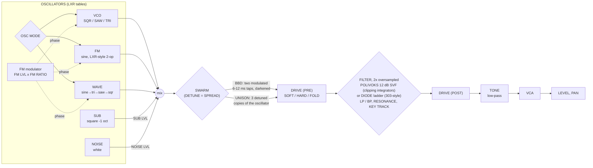
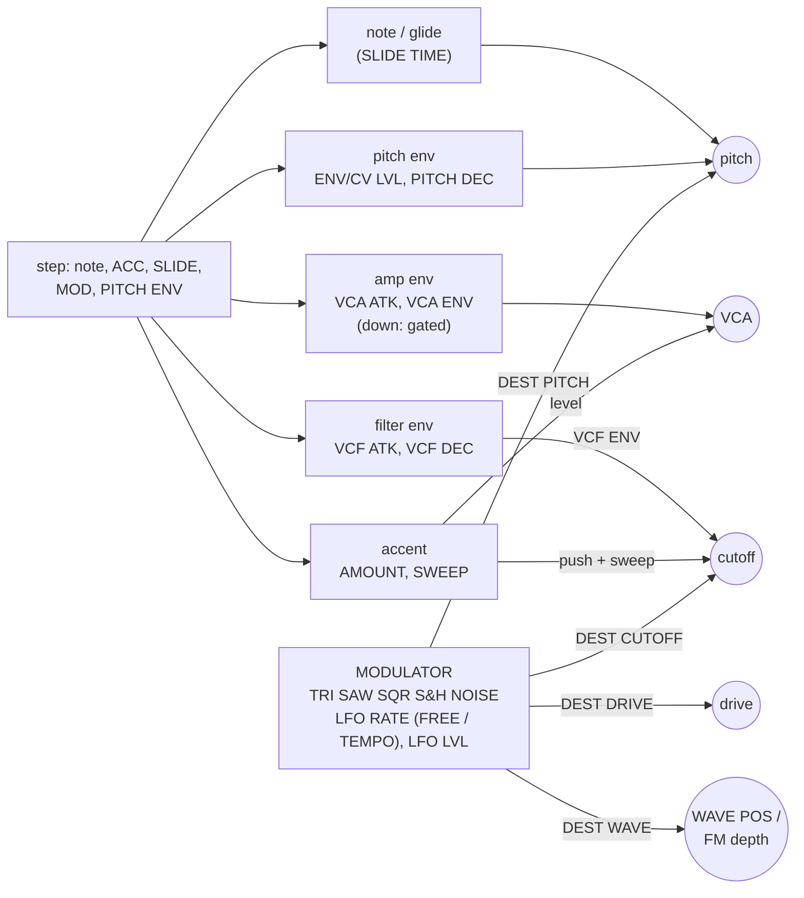
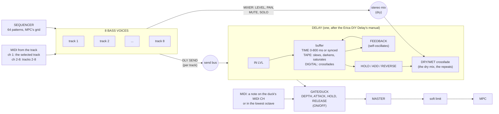

# The voice map: from LXRXXL to LXRXXL BAZZLINE

How the bass voices were made from LXRXXL's LXR system, what the Bassline path added, and how the two effects sit
after them. Every block here is written in this repository. The only code taken from elsewhere is the LXR's oscillator
tables (LXR02Open, `third_party/lxr02open/Core/DSPAudio/wavetable.c`). Nothing is Erica Synths' code: the Bassline,
the DIY Delay and the gate/duck are emulated from their public manuals.

## 1. What came from LXRXXL (the LXR system)

| LXRXXL / LXR02Open | In BAZZLINE |
|---|---|
| The LXR oscillator's band-limited tables: `sawTable`, `recTable`, `triTable` (11 octaves x 1024) and `sine_table` | Every oscillator reads them: the VCO's SAW / SQR / TRI, the sub (square, -1 octave), FM's sine carrier and modulator, the WAVE morph |
| The LXR's table choice per octave (`Oscillator.c` `freqToTableIndex`): one table per octave of the played note, so high notes don't alias | The same rule (`voice.c`, from the note directly) |
| The LXR's 32-bit phase accumulators and table reads with linear interpolation (`calcWavetableOsc`) | The same phase model (`rd1024`, `rd_sine`) |
| The LXR drum voice's FM: a second oscillator modulating the first one's phase (DRUM1-3 "FM") | **FM LVL** and **FM RATIO**: a sine modulator at a ratio of the note (1/4 .. 8), on any oscillator mode |
| LXR02Open's waveform morph (blending neighbouring waveforms) | **WAVE** mode: WAVE POS morphs sine → triangle → saw → square |
| LXRXXL's sequencer: patterns of tracks, each with its own length (to 64 steps, 4 bars), MPC's song position as the clock, the next pattern queued at the pattern's end | The sequencer (`seq.c`), with 8 tracks and the Bassline's step functions added |
| LXRXXL's Force integration: the panel as image keys with LEDs, engine-driven values reported to MPC, the whole state in MPC's project, RESET to the factory project | The same (`engine.c`, `src/wrapper/vst2_wrap.c`) |

## 2. What the Bassline path added (one voice, x 8 tracks)

DRIVE POS chooses PRE or POST: the drive runs once, either before or after the filter.

The modulation that drives the voice:

The Bassline / acid behaviour, block by block:

| Block | How it behaves |
|---|---|
| Slide | A step with SLIDE holds its gate into the next step. The next note glides (SLIDE TIME) without new envelopes. A slide into a rest holds the note half a step more |
| Accent | An accented note is louder (AMOUNT), opens the filter more and gets the 303's short filter decay. **SWEEP** charges on every accent and decays over about 0.6 s, so accents in a row climb |
| VCA ENV | Fully down: the VCA follows the gate (DB-01's gated setting). Turned up: each note decays on its own (plucks, 808s, long basses) |
| PITCH ENV | A downward pitch sweep from up to +4 octaves (ENV/CV LVL, PITCH DEC), on the steps marked PITCH ENV (or every step when none are marked) |
| MOD | The modulator plays on the steps marked MOD (or always when none are marked) |
| Polivoks | A state-variable filter whose integrators clip, which gives it its grit. It self-oscillates at full RESONANCE |
| Diode | Four one-pole stages with saturating feedback, for the 303 squelch |
| BBD swarm | Two short delays, slowly modulated against each other and darkened like a bucket-brigade chip: the DB-01's thick detune |

## 3. The routing of the whole instance

1. The mixer sums the voices in stereo (LEVEL, PAN; MUTE and SOLO decide which sound). Each track also feeds the
   delay's send bus through its DLY SEND, so the delay hears only what is sent to it.
2. The delay's DRY/WET crossfades between the dry mix and the repeats.
3. The gate/duck comes after the delay, so a duck pumps the delay's repeats too, like a sidechain on a bus.
4. MASTER sets the level of the whole instance; a gentle soft limiter keeps eight voices and a self-oscillating delay
   from clipping MPC's input.

## 4. Where it is in the code

| File | What |
|---|---|
| `src/voice.c` | One bass voice: oscillators (LXR tables), swarm, drive, filters, envelopes, accent, slide, modulator |
| `src/fx.c` | The delay and the gate/duck |
| `src/seq.c` | The sequencer: clock, play modes, scales, arpeggio, slides, RND PATT |
| `src/ui.c` | The front panel: keys, SHIFT functions, the encoders, the display |
| `src/bl.c`, `src/factory.c` | The instance and the audio block; the factory sounds and demo patterns |
| `src/engine.c`, `src/store.c` | MPC's side: parameters, MIDI, the state chunk |
